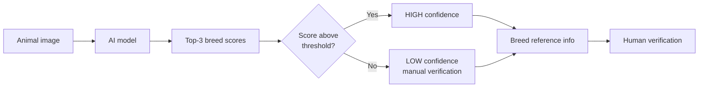
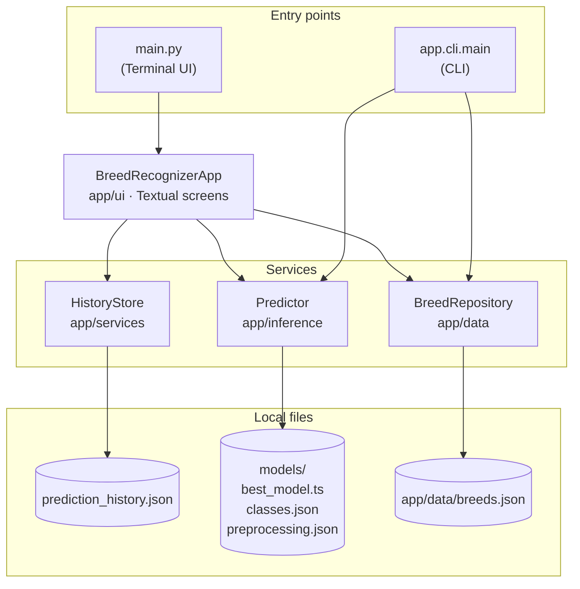
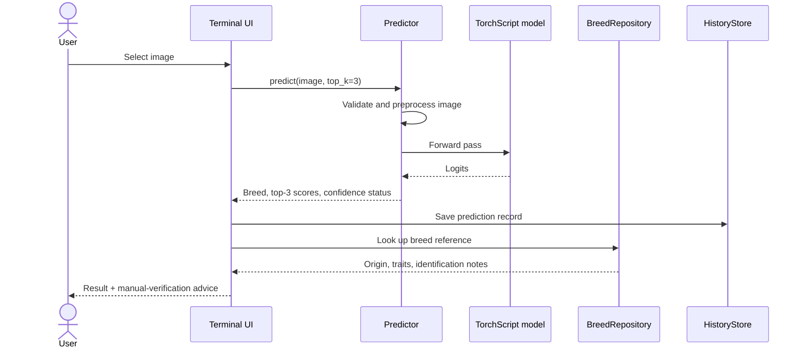
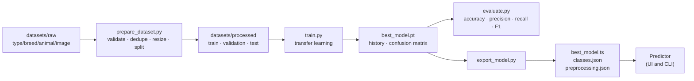

# Indian Breed AI

**Image-based breed recognition for Indian cattle and buffaloes — a terminal-first research tool with a confidence-aware workflow.**


Indian Breed AI combines a structured breed reference database, a reproducible
image pipeline, a transfer-learning classifier, and a full-screen terminal
interface. It is built to **assist** breed identification, not to replace expert
verification.

---

## Table of Contents

- [Problem](#problem)
- [Solution](#solution)
- [Features](#features)
- [Architecture](#architecture)
- [Project Structure](#project-structure)
- [Installation](#installation)
- [Usage](#usage)
- [Training Pipeline](#training-pipeline)
- [Dataset](#dataset)
- [Configuration](#configuration)
- [Testing](#testing)
- [Limitations](#limitations)
- [Roadmap](#roadmap)

---

## Problem

Bharat Pashudhan and related livestock workflows need practical breed
identification across varied images, regions, lighting, backgrounds, and animal
poses. Many indigenous breeds share visual traits, so an image classifier should
support field and research workflows while keeping a human in the loop.

## Solution



Model output, confidence policy, and reference metadata are kept separate.
Reference information supports investigation; it does not prove that an image
belongs to the predicted breed.

## Features

| Area | What it does |
|------|--------------|
| **Recognition** | Transfer-learning classifier (MobileNetV3-Small, EfficientNet-B0, ResNet18) returning top-3 breed scores |
| **Confidence policy** | Configurable threshold; low-confidence results are flagged for manual verification |
| **Breed database** | 23 Indian breeds (15 cattle, 8 buffalo) with aliases, origin, traits, and uncertainty notes |
| **Terminal UI** | Keyboard-driven Textual app: predict, browse breeds, history, model status, settings |
| **CLI** | Scriptable commands for breed lookup, app info, and prediction |
| **History** | Local JSON log of successful predictions; corrupt files are preserved, not overwritten |
| **Data pipeline** | Image validation, duplicate detection, resizing, leakage-safe splits, reports, optional augmentation |

---

## Architecture

### System overview



### Prediction flow



### Design principles

- **The UI owns no model logic.** It calls `Predictor`; preprocessing and inference live in one place.
- **No fabricated output.** Without a trained model, the app reports that prediction is unavailable.
- **Scores are not probabilities.** Model scores are shown as-is and are not scientifically calibrated.
- **Reference data is not evidence.** Breed metadata supports a human decision; it does not confirm one.

See [docs/architecture.md](docs/architecture.md) for component boundaries.

---

## Project Structure

```text
breed-recognition/
├── main.py                  # Launches the terminal UI
├── app/
│   ├── cli/                 # Command-line interface
│   ├── config/              # Settings (paths, confidence threshold)
│   ├── core/                # Breed model, lookups, application errors
│   ├── data/                # breeds.json + BreedRepository
│   ├── data_pipeline/       # Dataset validation, splitting, reports
│   ├── inference/           # Predictor: model loading and inference
│   ├── models/              # Model architectures, training helpers, metrics
│   ├── services/            # Prediction history persistence
│   └── ui/                  # Textual terminal application
├── scripts/                 # prepare, stats, train, evaluate, export
├── datasets/                # Local images (git-ignored)
├── models/                  # Trained artifacts (weights git-ignored)
├── docs/                    # Architecture, dataset, model, development guides
└── tests/                   # pytest suite
```

---

## Installation

Requires **Python 3.10+**.

```bash
git clone https://github.com/dipu01-code/breed-recognition.git
cd breed-recognition
python -m venv .venv
source .venv/bin/activate        # Windows: .venv\Scripts\activate
python -m pip install -r requirements.txt
```

## Usage

### Terminal UI

```bash
python main.py
```

| Key | Action |
|-----|--------|
| `↑` / `↓` | Navigate |
| `Enter` | Select / run prediction |
| `→` | Jump to the file list (Predict screen) |
| `←` | Step back: files → folders → menu |
| `Esc` | Return home |
| `R` | Refresh |
| `?` | Help |
| `Q` | Quit |

**Screens**

- **PREDICT** — browse folders from the project root, preview image metadata, and run a prediction.
- **BREEDS** — search the breed database and view details.
- **HISTORY** — review previous predictions stored in `prediction_history.json`.
- **MODEL** — check whether a trained model and labels are installed.
- **SETTINGS / ABOUT** — current paths, threshold, and project information.

### Command line

```bash
python -m app.cli.main breeds                  # list all breeds
python -m app.cli.main breeds --type buffalo   # filter by animal type
python -m app.cli.main breeds --search gir     # search names and aliases
python -m app.cli.main info --breed gyr        # breed details as JSON
python -m app.cli.main info                    # version, paths, model status
python -m app.cli.main predict path/to/image.jpg
```

---

## Training Pipeline



```bash
python scripts/prepare_dataset.py --raw datasets/raw --output datasets/processed --seed 42
python scripts/train.py --data datasets/processed --output models --epochs 10
python scripts/evaluate.py --checkpoint models/best_model.pt --data datasets/processed --split test
python scripts/export_model.py --checkpoint models/best_model.pt --output models/best_model.ts
```

Training uses MobileNetV3-Small by default (`--architecture efficientnet_b0` or
`resnet18` are also available), with augmentation, class-weighted loss,
deterministic seeds, validation, checkpointing, and a confusion matrix.

> **Note:** This repository does not ship a real dataset or a production
> checkpoint, so no accuracy, precision, recall, or F1 results are claimed. The
> pipeline has been smoke-tested end to end on synthetic images only.

See [docs/model.md](docs/model.md) for artifact and inference details.

## Dataset

Place images locally using this layout:

```text
datasets/raw/<animal_type>/<breed>/<animal_id>/<image>
datasets/processed/{train,validation,test}/<breed>/<image>.jpg
```

- Each animal folder is a split group, so all views of one animal land in the
  same split — preventing leakage between training and evaluation.
- Every breed needs enough animals to appear in both the training and
  validation splits.
- Raw and processed datasets are ignored by Git.

See [docs/dataset.md](docs/dataset.md) and [datasets/README.md](datasets/README.md).

## Configuration

| Variable | Default | Description |
|----------|---------|-------------|
| `BREED_CONFIDENCE_THRESHOLD` | `0.70` | Minimum top score (0–1) for a HIGH confidence result |

```bash
BREED_CONFIDENCE_THRESHOLD=0.8 python main.py
```

## Testing

```bash
python -m pytest -q
python scripts/dataset_stats.py --raw datasets/raw --output datasets/processed
```

The suite covers the CLI, breed database, data pipeline, predictor, history
store, and headless UI navigation. See [docs/development.md](docs/development.md).

---

## Limitations

- Recognisable breeds are limited to the classes present in the training data;
  the breed database is broader than any trained model.
- Image quality, blur, lighting, background, and viewpoint affect predictions.
- Visually similar breeds can be hard to distinguish.
- Human verification remains essential, especially for low-confidence results.
- This is an MVP and has not been validated on field data.

## Roadmap

- [ ] Larger, field-representative dataset covering more breeds
- [ ] Animal detection before breed classification
- [ ] Confidence calibration
- [ ] Model quantization for edge hardware
- [ ] Mobile deployment and offline inference
- [ ] BPA API integration where appropriate and authorized
